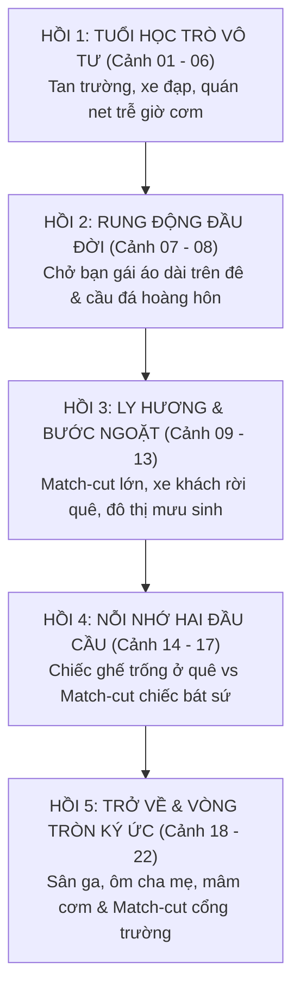

# DÒNG CHẢY CẢM XÚC & SƠ ĐỒ MATCH-CUT ĐIỆN ẢNH (FLOW & TRANSITIONS)
## Dự án: Vòng Tròn Ký Ức Tuổi Thơ (22 Phân Cảnh 16:9 Chuẩn Điện Ảnh 4K)

---

### 1. SƠ ĐỒ DÒNG CHẢY CẢM XÚC 5 HỒI (5-ACT CINEMATIC ARC)

---

### 2. BẢN ĐỒ 3 ĐIỂM MATCH-CUT ĐIỆN ẢNH BẬC THẦY

#### Match-Cut 1: Cảnh 09 (Bước Ngoặt Năm Tháng — Temporal Transition)
- **Điểm cắt A:** Cận cảnh áo sơ mi trắng học sinh treo trên móc gỗ nhà quê $\to$ Cắt khớp 1:1 sang áo khoác gió nâu của người lớn trên móc phòng trọ.
- **Điểm cắt B:** Cận cảnh bàn tay thiếu niên siết ghi đông xe đạp $\to$ Cắt khớp sang bàn tay người lớn siết quai ba lô.
- **Biến chuyển âm thanh:** Tiếng xích xe đạp hòa dần sang tiếng động cơ xe khách đường dài.

#### Match-Cut 2: Cảnh 17 (Chiếc Bát Sứ Nối Liền Hai Thế Giới — Soul Bridge)
- **Điểm cắt:** Đáy chiếc bát sứ trắng viền xanh vừa chạm mặt bàn trọ ở thành phố $\to$ Match-cut góc máy và vị trí sang chiếc bát sứ cùng loại trên mâm cơm gia đình ngày xưa.
- **Biến chuyển ánh sáng:** Sắc xanh xám lạnh phòng trọ chuyển tức thì sang sắc vàng ấm ký ức quê nhà.
- **Biến chuyển âm thanh:** Tiếng đáy bát chạm mặt gỗ `*lách cách*` nối liền hai không gian.

#### Match-Cut 3: Cảnh 22 (Vòng Tròn Ký Ức Khép Lại — Circular Narrative)
- **Điểm cắt:** Máy quay từ mâm cơm sum họp lùi qua khung cửa sổ mở ra sân đêm, giữ khung cửa sổ sáng vàng ở giữa khung hình $\to$ Match-cut bố cục hình học sang khung cổng trường làng rợp bóng cây trong nắng sớm, cậu bé năm xưa đạp xe ra đường.
- **Ý đồ triết học:** Khẳng định vòng tròn ký ức tuổi thơ không bao giờ mất đi, nó là ngọn lửa ấm nuôi dưỡng tâm hồn mỗi con người trên suốt hành trình trưởng thành.
